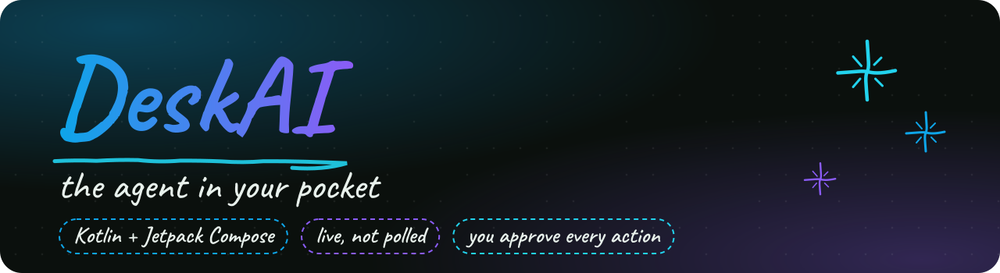
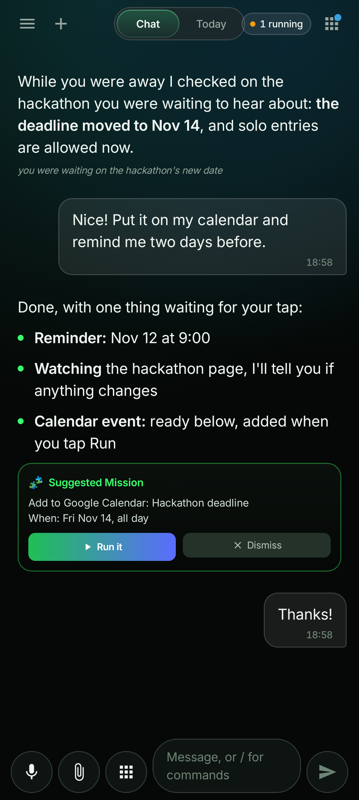
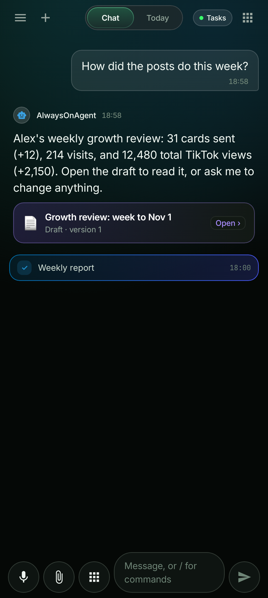
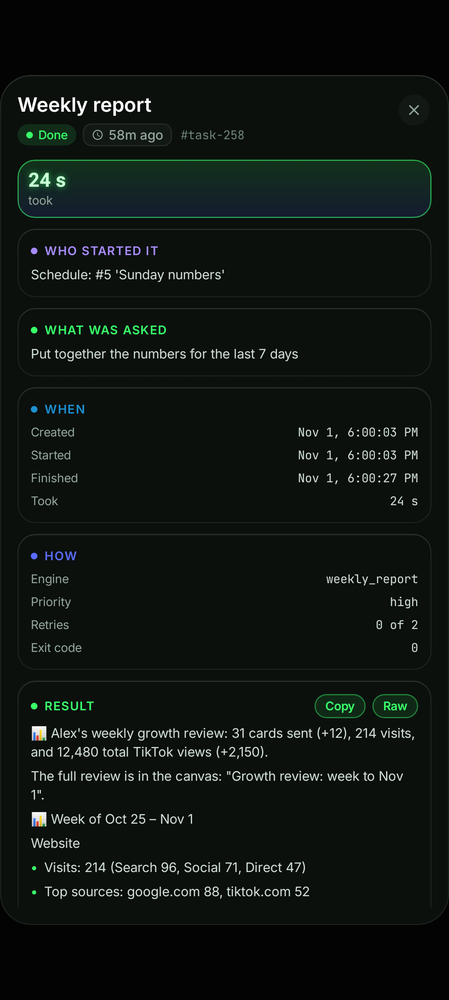
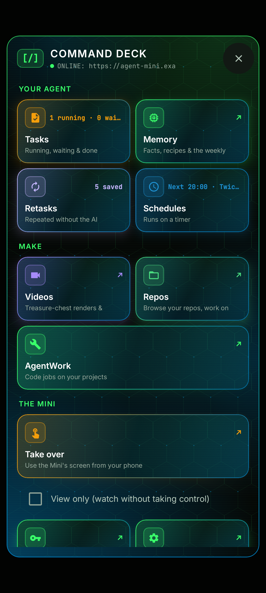
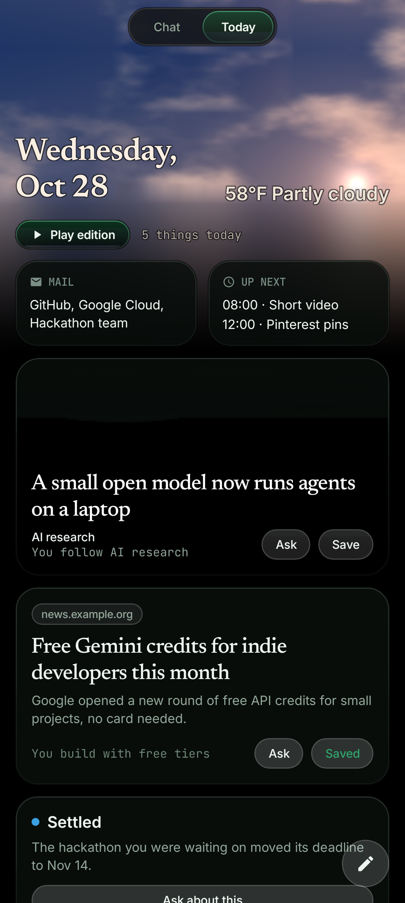
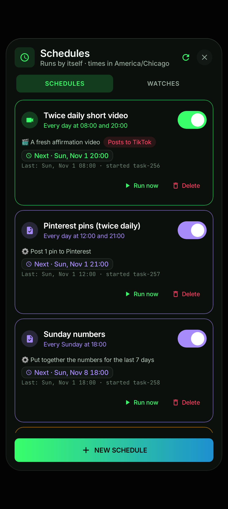
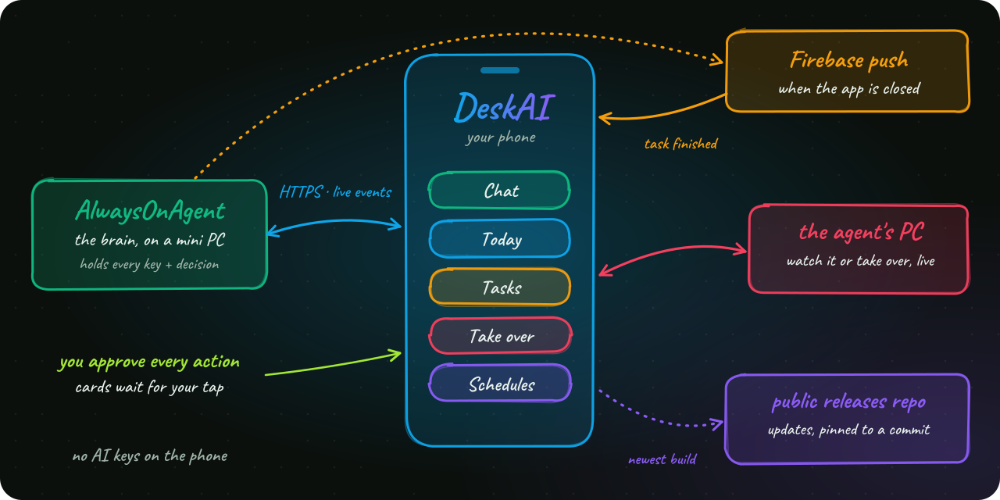

<!-- DeskAI -->

<p align="center"></p>

<p align="center">    </p>

The native Android app for a personal AI agent: one place to chat with it, watch it work live, approve what it wants to do, and even take over the PC it controls. It's the only interface to [AlwaysOnAgent](https://github.com/TheVibeCheckProject/AlwaysOnAgent-Showcase), and it ships to a real phone: 100+ builds so far.


&nbsp; **Live, not polled.** Tasks stream in over server-sent events while the app is open, and Firebase pushes cover it when it's closed.

&nbsp; **You approve every action.** Anything the agent wants to do on the owner's accounts arrives as a card with the exact action, and nothing happens until the owner taps Run.

&nbsp; **Take over the agent's PC.** Watch (View only) or control the machine the agent is driving, with a live narration of each step, from anywhere.

&nbsp; **A designed product, not a demo.** A Today screen with a live sky that follows the real weather and clock, inline video, slash commands and voice input. Screenshot tests guard the look.

&nbsp; **Updates done right.** Over-the-air updates are pinned to an exact commit (no stale CDN copies), and the app tries several release sources in order, so moving a repo never breaks updates.

&nbsp; **Secure by default.** HTTPS over a private Tailscale network first, the home network as a fallback, the token in a header, and signed, expiring links for shared media.

&nbsp; **Gated by CI.** Every push builds the app and runs the unit tests, every screenshot test and Android Lint on a Windows machine. Any failure blocks the change.


| **~25k**<br><sub>lines of Kotlin</sub> | **100+**<br><sub>builds shipped</sub> | **Jetpack**<br><sub>Compose UI</sub> | **Roborazzi**<br><sub>screenshot tests</sub> |
|:---:|:---:|:---:|:---:|


<table><tr><td align="center" valign="top"><br><sub><b>Chat</b>: it followed up while you were away; the calendar event waits for your tap</sub></td><td align="center" valign="top"><br><sub><b>Weekly report</b>: written on its own every Sunday, with a draft to open</sub></td><td align="center" valign="top"><br><sub><b>Task details</b>: who started it, what was asked, how long it took, the result</sub></td></tr><tr><td align="center" valign="top"><br><sub><b>Command Deck</b>: everything the agent can do, with live details</sub></td><td align="center" valign="top"><br><sub><b>Today</b>: a daily edition under a sky that follows the weather and clock</sub></td><td align="center" valign="top"><br><sub><b>Schedules</b>: videos, posts, reports and reminders that run by themselves</sub></td></tr></table>


The app holds no AI keys and no business logic: every decision is made on the agent's server, and the app shows it, streams it and asks the owner. That keeps the phone simple and the secrets in one place.

<p align="center"></p>


| Start here | What you'll find |
|---|---|
| [`AlwaysOnAgentClient.kt`](app/src/main/java/com/example/data/remote/AlwaysOnAgentClient.kt) | Everything the app says to the agent, and connection failover |
| [`TaskEvents.kt`](app/src/main/java/com/example/data/remote/TaskEvents.kt) | The live event stream that keeps tasks up to date |
| [`ChatScreen.kt`](app/src/main/java/com/example/ui/screens/ChatScreen.kt) | Chat: messages, approval cards, the running task card |
| [`TodayScreen.kt`](app/src/main/java/com/example/ui/today/TodayScreen.kt), [`WeatherAtmosphere.kt`](app/src/main/java/com/example/ui/today/WeatherAtmosphere.kt) | The Today screen and its sky, drawn from the real weather and clock |
| [`TakeOverScreen.kt`](app/src/main/java/com/example/ui/dialogs/TakeOverScreen.kt) | Watching or driving the agent's PC from the phone |
| [`WatchesPanel.kt`](app/src/main/java/com/example/ui/dialogs/WatchesPanel.kt) | Watches: tell me when an email, a web page, a search or a calendar event needs me |
| [`UpdateSource.kt`](app/src/main/java/com/example/data/remote/UpdateSource.kt) | Over-the-air updates: commit-pinned, several sources in order |
| [`MediaAuth.kt`](app/src/main/java/com/example/data/remote/MediaAuth.kt) | Which hosts get the token, and signed links for shared media |
| [`DeskAIMessagingService.kt`](app/src/main/java/com/example/service/DeskAIMessagingService.kt) | Push notifications |
| [`ScreenshotTest.kt`](app/src/test/java/com/example/ui/ScreenshotTest.kt) | The screenshot tests behind the pictures above |


JDK 17, the Android SDK (platform 36) and Gradle 9.3.1 or newer (CI uses 9.8.0); details in [BUILD.md](BUILD.md). Push notifications need your own Firebase `google-services.json`, which is never in git.

```powershell
gradle assembleDebug          # → app/build/outputs/apk/debug/app-debug.apk
gradle testDebugUnitTest      # unit and screenshot tests
gradle lintDebug              # Android Lint
```

---

> **About this copy.** This is a sanitized snapshot of the Android companion app for a self-hosted,
> single-user personal agent. It is not the live private repo: history and built APKs are not included, and names,
> places, accounts and network addresses are placeholders (the owner is "Alex"). Code licensed MIT; the bundled
> fonts (Inter, JetBrains Mono, Newsreader) keep their own SIL Open Font License 1.1.
